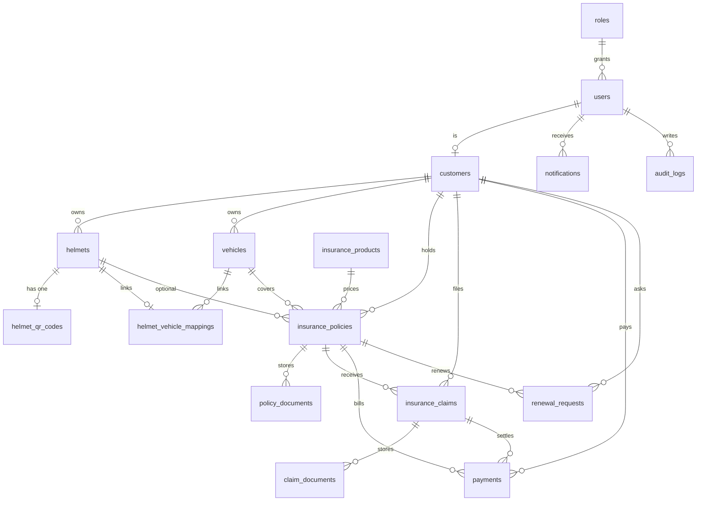

# Entity relationship diagram

`otp_verifications` is keyed by mobile and is not a foreign key, so a request can be stored before it is consumed. `sequences` and `app_settings` are operational tables without business relationships.
